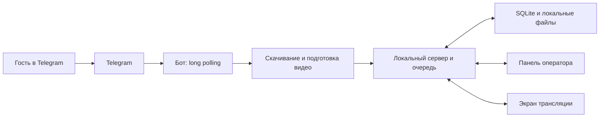

# Техническое задание: система видеопоздравлений для мероприятий

## 1. Назначение проекта

Создать локальное приложение для корпоративных мероприятий, которое:

- принимает видеокружочки гостей через Telegram-бота;
- скачивает и хранит их на ноутбуке;
- формирует очередь показа;
- позволяет оператору проверять поздравления и управлять трансляцией;
- воспроизводит один кружочек со звуком на большом экране;
- добавляет просмотренные поздравления на стену в виде круглых статичных превью;
- сохраняет данные и очередь при перезапуске.

Для получения новых сообщений нужен интернет. Уже скачанные и подготовленные видео должны воспроизводиться без интернета.

## 2. Состав системы

| Компонент | Ответственность |
| --- | --- |
| Telegram-бот | Общение с гостями, получение кружочков, ответы о результате приёма |
| Обработчик видео | Скачивание, проверка, подготовка совместимого видео и превью |
| Локальный сервер | Настройки, база данных, модерация, очередь, управление показом |
| Панель оператора | Управление мероприятием на экране ноутбука |
| Экран трансляции | Полноэкранный показ на проекторе или втором мониторе |

Все компоненты работают на одном ноутбуке. Публичный сервер, домен и вебхуки для первой версии не нужны.



## 3. Технологический стек

| Часть | Решение |
| --- | --- |
| Язык серверной части | Python |
| Telegram-бот | aiogram |
| Локальный API | FastAPI |
| База данных | SQLite |
| Интерфейс | React + TypeScript |
| Обновления интерфейсов | WebSocket |
| Проверка и обработка видео | FFmpeg и ffprobe |
| Среда разработки | VS Code + Codex |
| Основной способ запуска | Windows desktop-приложение Electron, запускающее локальный сервер |

Точные версии зависимостей Codex должен выбрать при реализации, проверить совместимость и закрепить в файлах зависимостей.

В готовой версии сервер раздаёт собранный интерфейс. Отдельный сервер разработки React нужен только при разработке.

Бот запускается как фоновая задача приложения, обработка видео — через ограниченную очередь фоновых работ.

В первой версии запускать только один экземпляр приложения и один серверный процесс: несколько процессов не должны одновременно читать Telegram или управлять очередью.

## 4. Основной сценарий мероприятия

1. Оператор запускает приложение.
2. Создаёт или выбирает мероприятие.
3. Указывает название компании и текст на экране.
4. Включает приём поздравлений.
5. Открывает панель управления на ноутбуке.
6. Открывает экран трансляции на втором мониторе.
7. Запускает показ из панели; экран сразу пробует воспроизведение со звуком. Если браузер фактически блокирует autoplay, нажимает существующую кнопку «Запустить показ» на экране трансляции для повторной попытки. Предварительная подготовка экрана не требуется.
8. Гости сканируют QR-код и отправляют кружочки боту.
9. Система скачивает и подготавливает видео.
10. Готовые поздравления проходят выбранный режим модерации.
11. Оператор добавляет одобренные видео на стену или в повторный показ.
12. При свободном экране оператор может запустить конкретное видео стены из панели; команда не прерывает уже идущий ролик.
13. Экран показывает выбранную оператором стену, а автопоказ крутит её элементы.
14. По окончании мероприятия оператор останавливает приём и показ. Данные остаются сохранёнными.

## 5. Мероприятия и привязка гостей

Приложение поддерживает несколько сохранённых мероприятий, но принимать поздравления и показывать их может только одно активное мероприятие.

У каждого мероприятия есть собственные:

- настройки;
- поздравления;
- очередь;
- операторская стена;
- ссылка и QR-код для подключения гостей.

QR-код содержит ссылку на Telegram-бота с уникальным кодом мероприятия. Код мероприятия не содержит секретов приложения.

Когда гость открывает такую ссылку, бот запоминает выбранное мероприятие для этого пользователя. Кружочки принимаются только в это мероприятие, если приём открыт.

Оператор настраивает от 1 до 15 столов и необязательное задание для каждого. После каждого полученного кружочка бот временно сохраняет технические данные Telegram и спрашивает, с какого стола отправлено именно это видео. Бот показывает столы inline-кнопками по 5 на странице, с переходами «Назад» и «Далее», и подтверждает только номер стола. Один Telegram-аккаунт может указывать разные столы для разных роликов. Если стол не выбран за 15 минут, временная запись удаляется, а гость отправляет кружочек заново.

Если гость:

- открывает обычную ссылку на бота — получает предложение отсканировать QR-код мероприятия;
- использует ссылку закрытого мероприятия — получает сообщение, что приём завершён;
- открывает ссылку нового мероприятия — его привязка переключается на новое мероприятие.

Нельзя автоматически переносить сообщения, отправленные по старой ссылке, в новое мероприятие.

## 6. Telegram-бот

### Поддерживаемый контент

В первой версии бот принимает только Telegram-видеокружочки — сообщения типа `video_note`.

Обычные видео, фотографии, документы и текст не попадают в очередь. Бот отвечает понятной инструкцией, как отправить кружочек.

### Команды

| Команда | Поведение |
| --- | --- |
| `/start <код>` | Подключение к мероприятию и инструкция |
| `/start` | Инструкция открыть ссылку или QR-код мероприятия |
| `/help` | Краткое объяснение отправки кружочка |

После каждого полученного видеокружочка бот отправляет отдельное сообщение с выбором стола. Пока стол не указан, полноценный `Submission` не создаётся, видео не готовится, не расходует лимит гостя и не появляется в панели. После выбора стола создаётся `Submission` с номером стола и снимком задания.

### Ответы гостю

После сохранения входящего сообщения:

> Кружочек получен, готовим его к показу.

После успешной подготовки:

- автоматическая модерация: «Спасибо! Поздравление принято и готово к показу»;
- ручная модерация: «Спасибо! Поздравление отправлено организатору на проверку».

При ошибке обработки бот сообщает, что видео не удалось подготовить, и предлагает отправить новое.

Не обещать гостю точное время показа.

### Ограничения по умолчанию

| Параметр | Значение |
| --- | --- |
| Максимальная длительность | 60 секунд |
| Максимальный размер | 20 МБ |
| Лимит поздравлений | 3 принятых кружочка от гостя на мероприятие |
| Параллельная обработка видео | 1 задача |

Лимиты редактируются в настройках в пределах возможностей используемого Telegram API.

Отклонённые по техническим причинам сообщения не расходуют лимит принятых поздравлений.

Длительность и размер проверяются по фактически полученному файлу, а не только по метаданным Telegram.

## 7. Приём и обработка видео

Последовательность обработки:

1. Проверить привязку гостя и доступность приёма.
2. Проверить, не было ли это сообщение принято ранее.
3. Сохранить запись о входящем сообщении в базе.
4. Скачать файл во временную папку.
5. Проверить файл через ffprobe.
6. Подготовить браузерно-совместимую копию видео.
7. Создать статичное превью.
8. Переместить готовые файлы в постоянную папку мероприятия.
9. Обновить статус в базе.
10. Применить текущий режим модерации.

Исходный файл сохраняется отдельно от версии для воспроизведения.

Подготовленная версия должна содержать совместимое MP4-видео; при наличии звука — совместимую аудиодорожку.

Отсутствие аудиодорожки допускается. Повреждённый или непригодный для обработки файл получает статус ошибки.

Обработка не должна блокировать API и управление показом. Для каждой операции задаются тайм-ауты. Ошибка одного файла не останавливает остальные задания.

Файлы сначала записываются во временное место и только после успешной подготовки становятся доступными для показа.

### Защита от повторов

Повторная доставка одного Telegram-сообщения не создаёт новую запись. В базе действует уникальность по идентификаторам чата и сообщения.

Повторная отправка гостем того же видео отдельным сообщением считается новой отправкой и учитывается в лимите.

## 8. Модерация

### Автоматический режим

После успешной подготовки видео система автоматически одобряет его. В очередь и на стену ролик не попадает автоматически: оператор управляет составом стены отдельно.

### Ручной режим

После подготовки видео попадает в раздел «На проверке». Оператор может:

- посмотреть превью;
- воспроизвести ролик в панели;
- изменить отображаемое имя;
- одобрить;
- отклонить.

При одобрении видео становится доступным для показа, повторного показа и добавления на стену. Само одобрение не создаёт `QueueItem` и не добавляет ролик на стену.

Предпросмотр в панели по умолчанию без звука. Оператор может включить звук для проверки.

### Переключение режима

Переключение применяется к видео, обработка которых завершится после изменения настройки.

Уже ожидающие ручной проверки поздравления не одобряются автоматически при переключении в автоматический режим. Для них нужна отдельная команда «Одобрить все ожидающие» с подтверждением.

Уже одобренные видео остаются в очереди при переходе в ручной режим.

## 9. Очередь и управление показом

Модерация и воспроизведение — независимые настройки:

- модерация определяет, какие видео допущены;
- состояние показа определяет, когда они воспроизводятся.

Очередь в панели оператора — технический плейлист конкретных запусков. `QueueItem` создаётся для повторного показа, текущего запуска из стены и циклического автопоказа. Состав стены задаёт оператор.

### Режимы показа

Событие имеет режим показа:

- `auto_loop` — автопоказ: сервер сам запускает элементы стены и повторяет их по кругу до команды «Остановить показ»;
- `interactive_wall` — интерактивная стена: экран показывает элементы стены как шарики/кружочки, а ролик запускается только кликом по конкретному элементу.

В интерактивной стене отображаются только элементы `wall_items`. Если оператор убирает ролик со стены, шарик исчезает. После клика сервер создаёт технический `QueueItem` для выбранного `Submission`. Экран не завершает показ автоматически после конца видео: он остаётся открытым, позволяет воспроизвести ролик повторно и возвращает стену только после нажатия крестика, который подтверждает завершение серверу. Следующий ролик не выбирается автоматически.

### Команды оператора

| Команда | Поведение |
| --- | --- |
| Запустить | Начать или продолжить показ очереди |
| Пауза | Приостановить текущий ролик без перехода к следующему |
| Продолжить | Продолжить с текущей позиции |
| Пропустить | Остановить текущий ролик и перейти к следующему |
| Остановить показ | Остановить текущий ролик и вернуть его в начало очереди |
| Убрать из очереди | Удалить ожидающий ролик из очереди без удаления файла |
| Показать повторно | Добавить отдельное повторное воспроизведение в конец очереди |
| Добавить на стену | Добавить ready+approved ролик в операторскую стену |
| Убрать со стены | Удалить ролик из операторской стены без удаления файлов и истории |

Пропущенный ролик не считается просмотренным и не добавляется на стену. Для его показа оператор использует «Показать повторно».

Если показ остаётся запущенным, сервер не останавливает показ после последнего ролика стены. После успешного завершения сервер переводит текущий `QueueItem` в `completed` для истории и создаёт следующий технический `QueueItem` по составу `wall_items`. Показ продолжает идти по кругу до команды оператора «Остановить показ».

Если во время циклического показа оператор добавляет новое поздравление на стену, сервер добавляет для него технический `QueueItem`, чтобы оно вошло в текущий цикл.

В интерактивной стене естественное окончание видео не запускает следующий ролик и не меняет серверное состояние. После нажатия крестика экран подтверждает завершение: сервер скрывает технический `QueueItem` и переводит показ в ожидание выбора следующего шарика.

## 10. Экран трансляции

Маршрут: `/screen`.

### Ожидание

Отображаются:

- название компании;
- текст мероприятия;
- QR-код;
- инструкция «Отправьте видеопоздравление в Telegram»;
- операторская стена выбранных поздравлений;
- выбранный фон.

### Активный ролик

На экране:

- один крупный видеокружочек;
- имя гостя;
- номер стола и задание этого стола, если стол указан;
- операторская стена выбранных поздравлений в уменьшенном виде;
- название мероприятия и QR-код, если позволяет компоновка.

Видео отображается в круге с корректным обрезанием изображения.

Одновременно воспроизводится только один ролик. Кружочки на стене — статичные превью без видео и звука.

### После завершения

После подтверждённого окончания воспроизведения:

1. Сервер помечает этот показ завершённым.
2. Состав стены не меняется автоматически.
3. В `auto_loop` начинается следующий элемент стены. В `interactive_wall` ожидание выбора включается только после нажатия крестика на экране ролика.

Повторный показ не добавляет поздравление на стену и не создаёт второй экземпляр того же поздравления на стене.

### Ограничение стены

Стена всегда вмещает максимум 12 поздравлений. Добавление тринадцатого элемента отклоняется сервером.

Размер и позиции 12 кружочков фиксированы для каждой темы. В теме `new_year` они располагаются в зоне ёлки, в теме `neutral` — равномерной сеткой 3 по горизонтали и 4 по вертикали в рабочей зоне.

### Воспроизведение и ошибки

- Следующий ролик предварительно загружается.
- Пока видео не готово, показывается фон ожидания, а не чёрный экран.
- Если браузер отклонил запуск со звуком, очередь не продвигается; оператор видит требование нажать «Запустить показ» на экране.
- Если ролик не воспроизводится, система отмечает ошибку показа, уведомляет оператора и переходит к следующему.
- Незавершённый ролик не добавляется на стену.

Первая версия должна поддерживать обычный Full HD-экран и адаптироваться к другому соотношению сторон без обрезания основных элементов.

## 11. Согласованность сервера и экрана

Сервер — единственный источник состояния очереди. Панель и экран не должны самостоятельно выбирать следующий ролик.

Для каждого запуска видео сервер создаёт уникальный идентификатор воспроизведения.

Экран отправляет события:

- воспроизведение началось;
- воспроизведение завершилось;
- произошла ошибка;
- воспроизведение приостановлено.

Сервер принимает завершение только для текущего идентификатора. Повторные или запоздавшие сообщения не должны дважды продвигать очередь.

Разрешён только один активный экран воспроизведения. Открытие второй вкладки `/screen` не должно запускать второй ролик со звуком. Второй экран сообщает, что трансляция уже открыта.

При потере соединения с активным экраном сервер приостанавливает продвижение очереди. После восстановления связи экран получает полный актуальный снимок состояния.

После перезапуска сервера или перезагрузки экрана незавершённый ролик возвращается в начало очереди, а показ остаётся остановленным до команды оператора.

## 12. Панель оператора

Маршрут: `/admin`.

### Основные блоки

| Блок | Содержимое |
| --- | --- |
| Мероприятие | Название, статус приёма, режим модерации |
| Сейчас на экране | Гость, превью, прогресс, команды показа |
| На проверке | Подготовленные ролики, ожидающие решения |
| Очередь | Ожидающие ролики и изменение порядка |
| История | Просмотренные, пропущенные и отклонённые поздравления |
| Ошибки | Ошибки скачивания, обработки и воспроизведения |
| Настройки | Текст, оформление, ограничения, звук |
| Диагностика | Состояние бота, экрана и фоновой обработки |

### Доступные действия

- создать и выбрать мероприятие;
- открыть и закрыть приём;
- переключить модерацию;
- одобрить и отклонить ролики;
- изменить отображаемое имя гостя;
- изменить порядок очереди;
- управлять текущим воспроизведением;
- повторно отправить технически ошибочный ролик на обработку;
- убрать поздравление со стены;
- очистить историю показов без удаления роликов, очереди, стены и файлов;
- удалить поздравление вместе с файлами после подтверждения.

Полное удаление доступно из принятых кружочков, очереди, истории, стены и ошибок подготовки. Оно запрещено только если поздравление сейчас воспроизводится. После подтверждения удаляются `Submission`, связанные `QueueItem`, история, `WallItem` и подготовленные файлы.

Интерфейс должен явно показывать результат действий и ошибки.

## 13. Настройки мероприятия

| Настройка | Начальное значение |
| --- | --- |
| Название компании | Обязательное поле |
| Название мероприятия | Произвольное |
| Текст экрана | «С Новым годом!» |
| Режим модерации | Ручной |
| Приём сообщений | Закрыт до команды оператора |
| Громкость | 80% |
| Переход между роликами | 1 секунда |
| Тема | Новогоднее настроение |
| Максимальная длительность | 60 секунд |
| Максимальный размер | 20 МБ |
| Лимит на гостя | 3 поздравления |

Изменения названия, текста, громкости и оформления применяются без перезапуска.

Изменение оформления не должно прерывать текущий ролик.

В первой версии доступны две frontend-темы экрана: `new_year` («Новогоднее настроение») и `neutral` («Нейтральный»). Изменение темы применяется без перезапуска и не должно прерывать текущий ролик.

Тема `new_year` использует готовый новогодний фон, слой ёлки и рамку ёлочного шара для 12 кружочков. Тема `neutral` использует нейтральный фон, отдельную белую рабочую зону с прозрачностью 45% шириной 35% фона и круглые элементы с собственной рамкой в сетке 3×4.

## 14. Модель данных

Не использовать один общий статус для всех этапов. Разделить подготовку, модерацию и отдельные показы.

| Сущность | Основные данные |
| --- | --- |
| Event | ID, код подключения, название, настройки, состояние приёма |
| GuestBinding | Telegram user ID и выбранное мероприятие |
| PendingTableSelection | Временные Telegram-данные полученного видео до выбора стола, срок жизни 15 минут |
| Submission | Мероприятие, отправитель, Telegram message ID, номер стола и снимок задания, файлы, длительность, статусы |
| EventTable | Мероприятие, номер стола и необязательное задание |
| QueueItem | Поздравление, позиция, состояние конкретного показа |
| PlaybackSession | Текущий экран, идентификатор воспроизведения, состояние и время связи |
| AuditEntry | Действие оператора или системы, время, связанный объект |

### Статусы подготовки

`received` → `downloading` → `processing` → `ready`

При ошибке — `failed`, с сохранённой причиной и возможностью повторной обработки.

### Статусы модерации

`pending`, `approved`, `rejected`.

### Статусы конкретного показа

`queued`, `playing`, `completed`, `skipped`, `failed`, `cancelled`.

Повторный и циклический показ создают новый `QueueItem`, а не стирают историю предыдущего. Циклические элементы помечаются отдельно.

Очистка истории скрывает terminal `QueueItem` из панели оператора, но не удаляет `Submission`, файлы, активную очередь и стену.

На стену попадают только ready+approved поздравления, которые оператор явно добавил в `wall_items`. Завершение ролика не меняет состав стены.

## 15. Хранение файлов

```text
data/
  app.sqlite3
  events/
    <event_id>/
      originals/
      playback/
      thumbnails/
      background/
  temp/
  logs/
```

Пути формируются по внутренним идентификаторам. Имена гостей и Telegram-имена не используются как имена файлов.

База хранит относительные пути внутри папки данных. Пользовательский ввод не может задавать произвольный путь на диске.

После сбоя временные файлы проверяются и очищаются, а незавершённые задания восстанавливаются.

## 16. API и обновления интерфейса

HTTP API используется для:

- получения текущего состояния;
- настроек;
- модерации;
- управления очередью и показом;
- получения локальных видео и превью.

WebSocket используется для передачи:

- изменений очереди;
- новых поздравлений;
- состояния обработки;
- состояния воспроизведения;
- диагностических уведомлений.

При подключении клиент получает полный снимок состояния с номером версии. После разрыва соединения он повторно запрашивает актуальное состояние.

Повтор команды или события не должен приводить к двойному запуску, двойному одобрению либо потере элемента очереди. Изменения очереди выполняются транзакционно.

## 17. Локальный доступ и секреты

- Сервер слушает `127.0.0.1`.
- Интерфейсы доступны только с ноутбука.
- Токен Telegram-бота хранится в серверной конфигурации.
- Токен не передаётся в браузер, не записывается в логи и не попадает в Git.
- В репозитории есть `.env.example` без секретов.
- Сервер проверяет допустимый источник HTTP- и WebSocket-запросов.
- Панель и экран используют локальную сессию доступа, созданную приложением.

Доступ с телефона по Wi-Fi в первую версию не входит.

## 18. Восстановление и диагностика

После перезапуска должны сохраняться:

- мероприятия и настройки;
- все принятые поздравления;
- решения модерации;
- порядок ожидающей очереди;
- история показов;
- состав стены.

### Поведение при сбоях

| Ситуация | Ожидаемое поведение |
| --- | --- |
| Пропал интернет | Скачанные видео продолжают показываться; бот повторяет подключение |
| Прервалось скачивание | Задание повторяется после восстановления связи |
| Ошибка FFmpeg | Ролик получает ошибку; остальные задания продолжаются |
| Закрыт экран трансляции | Очередь перестаёт продвигаться |
| Перезапущено приложение | Незавершённый ролик возвращается в очередь; показ остановлен |
| Недостаточно места | Приём приостанавливается, оператор получает уведомление |
| Отсутствует локальный файл | Ролик не запускается, ошибка видна оператору |

Логи содержат время, тип события, внутренний ID ролика и диагностическую причину. Приложение ограничивает размер и количество логов.

## 19. Границы первой версии

В первую версию входят:

- локальный запуск;
- один Telegram-бот;
- одно активное мероприятие;
- несколько сохранённых мероприятий;
- приём кружочков;
- автоматическая и ручная модерация;
- очередь;
- один активный ролик со звуком;
- стена статичных превью;
- настройки компании, текста и фона;
- восстановление после сбоев.

На следующие версии откладываются:

- облачный сервер;
- несколько одновременно работающих площадок;
- управление с телефона;
- автоматическая модерация содержимого через ИИ;
- анимированная видеостена;
- композиции в форме ёлки или логотипа;
- сложные режимы плейлистов и расписаний;
- экспорт архива одной кнопкой.

## 20. Критерии приёмки

Первая версия считается готовой, если выполнены следующие проверки:

1. Гость подключается по QR-коду и отправляет настоящий Telegram-кружочек.
2. Видео скачивается, подготавливается и появляется в панели.
3. В ручном режиме ролик не показывается до одобрения.
4. В автоматическом режиме готовый ролик одобряется и доступен оператору для стены или повтора.
5. Переключение режима не одобряет ранее ожидающие проверки ролики.
6. Очередь воспроизводится в заданном порядке.
7. Оператор может добавить готовое одобренное видео на стену ровно один раз.
8. Пауза, продолжение, пропуск, остановка и повторный показ работают по ТЗ.
9. Вторая вкладка экрана не запускает параллельный звук.
10. Повторная доставка Telegram-сообщения не создаёт дубликат.
11. После перезапуска сохраняются очередь, модерация и история.
12. Без интернета скачанные видео продолжают показываться.
13. Повреждённый файл не останавливает систему.
14. Устаревшее событие завершения не переключает текущий ролик.
15. На ноутбуке оператора проведён прогон из не менее 50 роликов и проверены два часа непрерывной работы.
16. На реальном проекторе проверены полноэкранный режим, читаемость и вывод звука.

Для ключевой логики нужны автоматические тесты: дедупликация, переходы модерации, порядок очереди, обработка повторных событий и восстановление.

Реальный Telegram, браузерный звук и второй монитор проверяются отдельно вручную.

## 21. Этапы разработки для Codex

| Этап | Результат |
| --- | --- |
| 1. Каркас | Сервер, база, конфигурация, структура данных и простой интерфейс |
| 2. Приём | Бот, привязка к мероприятию, скачивание и защита от повторов |
| 3. Подготовка | FFmpeg, превью, фоновые задания и обработка ошибок |
| 4. Очередь | Модерация, состояния, команды и восстановление |
| 5. Экран | Один ролик, звук, ожидание, связь с сервером |
| 6. Панель | Модерация, очередь, настройки и диагностика |
| 7. Стена | Операторский набор превью и простые переходы |
| 8. Надёжность | Проверки сбоев, восстановление и базовая диагностика |
| 9. Простой запуск | Windows `.bat`, preflight, чек-листы оператора, восстановление и финальный smoke-test |
| 10. Визуальные темы экрана | Интеграция темы `new_year` и заготовки `neutral` на `/screen` без изменения правил очереди и playback |
| 11. Desktop-оболочка | Electron запускает локальный backend и открывает отдельные окна оператора и экрана без изменения серверной логики |
| 12.1 Portable Windows EXE | Один `VisualPozdr.exe` запускает bundled backend и окно оператора без Python, Node.js, PowerShell или установленного FFmpeg; экран трансляции открывается вручную из панели |
| 12.2 macOS demo | Общая кодовая база, отдельные arm64/x64 ZIP с `Visual Pozdr.app`, нативными backend и FFmpeg/ffprobe; пользователь указывает своего бота в личном `.env`; автоматическая сборка на macOS и ручная приёмка на целевом Mac |

Каждый этап должен завершаться работающим результатом и краткой инструкцией проверки.

Сложные анимации не должны задерживать проверку приёма, очереди и воспроизведения.

### Условия macOS demo

Mac-версия сохраняет правила приёма, столов, модерации, стены, очереди и playback Windows-версии.
Инструменты и Python включены в приложение; GitHub требуется только разработчику для сборки.
Поставка — ZIP с `.app` и инструкцией, данные — в `~/Library/Application Support/Visual Pozdr/`.
Демо имеет ad-hoc подпись без Developer ID/notarization, что может потребовать подтверждения
первого открытия в macOS. Успешная CI-сборка не заменяет ручную проверку Golden Gate 27.0.1,
Telegram, звука и второго монитора. Подробности — `docs/MAC_DEMO_BUILD.md` и `docs/MAC_DEMO_USER_GUIDE.md`.

## 22. Документы в репозитории

Codex должен создать:

- `SPEC.md` — это ТЗ;
- `ARCHITECTURE.md` — устройство приложения и правила взаимодействия;
- `AGENTS.md` — правила работы с проектом;
- `README.md` — установка, настройка бота и запуск;
- `.env.example` — пример конфигурации;
- инструкцию подготовки ноутбука к мероприятию.

В `AGENTS.md` зафиксировать:

- сервер управляет очередью;
- состояние сохраняется в SQLite;
- токены остаются на сервере;
- обработка видео не блокирует интерфейс;
- изменения поведения требуют обновления документации.

Следующий шаг для Codex — создать каркас проекта и реализовать первый этап.

Telegram, обработку видео и визуальное оформление добавлять последовательно, проверяя каждый этап по этому ТЗ.
